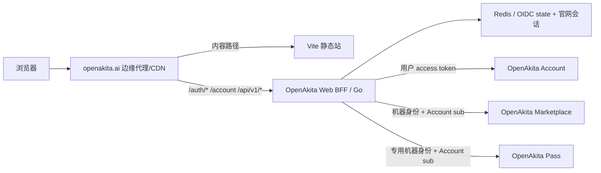

# OpenAkita 官网与 Go BFF 技术设计

- 状态：一期实施基线已冻结；二期 P2.1 Pass 摘要已落地
- 日期：2026-08-17
- 关联决策：`docs/adr/0001-static-site-go-bff.md`、`docs/adr/0002-pass-summary-integration.md`
- 接口契约：`docs/contracts/hub-api-v1.md`

## 1. 目标

官网当前承担三项职责：

1. 持续提供不依赖登录的品牌与教程静态内容；
2. 作为独立 OIDC Client 提供统一登录和账户菜单；
3. 提供只读的“我的 OpenAkita”Hub，聚合 Account、Marketplace 与 Pass 摘要。

设计必须保证：

- Account 是身份、会话链和统一权益权威；
- Marketplace 是资源领取、资源库和安装状态权威；
- Pass 是额度、当期用量和显示换算规则权威；
- 官网 BFF 不写入身份、权益或市场资产；
- 任一下游摘要失败只降级对应模块；
- BFF 故障不影响首页、下载和教程等静态页面。

## 2. 非目标

- 不在官网实现注册、改密、身份绑定或 License 激活；
- 不在官网实现资源领取、安装和完整资源库；
- 不在官网执行 Pass 充值、余额变更、钱包扣款、API Key 创建或支付；
- 不共享 Account、Marketplace 的 Cookie、数据库或内部代码；
- 不新增官网业务数据库；
- 不在一期迁移 Next.js。

## 3. 总体拓扑



静态站和 BFF 是两个独立健康域。边缘代理不得把静态页面的可用性绑定到 BFF 健康检查。

## 4. 仓库结构

一期按以下目标结构演进：

```text
openakita-web/
  assets/                         # 现有静态资产，第二周再规范为构建输入
  build-tools/
  docs/
  bff/
    go.mod
    go.sum
    cmd/openakita-web-bff/main.go
    internal/app/
    internal/config/
    internal/httpapi/
    internal/oidc/
    internal/session/
    internal/accountclient/
    internal/marketplaceclient/
    internal/passclient/
    internal/hub/
    internal/observability/
  Dockerfile.static
  Dockerfile.bff
```

Go 包职责：

| 包 | 职责 |
| --- | --- |
| `config` | 环境配置、生产安全校验 |
| `httpapi` | 路由、Cookie、CSRF、错误映射 |
| `oidc` | Discovery、PKCE、token交换、JWKS/ID token校验、刷新和退出 |
| `session` | Redis会话、OIDC state、token加密、撤销 |
| `accountclient` | userinfo与权益读取 |
| `marketplaceclient` | Marketplace只读摘要读取 |
| `passclient` | Pass只读额度与本月用量摘要读取及契约校验 |
| `hub` | 并发聚合、字段裁剪、模块级降级 |
| `observability` | 日志、指标、追踪和请求关联ID |

## 5. 路由与所有权

| 路径 | 所有者 | 认证 | 故障行为 |
| --- | --- | --- | --- |
| `/`、`/download/*`、`/services/*`、`/scenarios/*`、`/tutorials/*`、`/about/*`、`/terms/*`、`/privacy/*` | 静态站 | 无 | 不依赖BFF |
| `/auth/login` | BFF | 无 | Account不可用时返回受控错误页 |
| `/auth/callback` | BFF | OIDC state | 安全失败，不创建半成品会话 |
| `/auth/logout` | BFF | 官网会话 + CSRF | 先清本地会话，再进入Account退出链 |
| `/account` | BFF | 必须登录 | 未登录记录 `/account` 后发起OIDC |
| `/api/v1/session` | BFF | 可选 | 始终返回最小登录状态，不重定向 |
| `/api/v1/hub` | BFF | 必须登录 | 模块级降级；失效会话返回401 |
| `/health` | BFF | 无 | 仅表示进程存活 |
| `/ready` | BFF | 无 | 检查Redis和关键配置，不把下游短暂故障视为未就绪 |
| `/metrics` | BFF | 运维网络限制 | 不公开到互联网 |

## 6. OIDC流程

官网注册为 Account 的独立 `first_party` confidential client。

固定流程：

```text
GET /auth/login?return_to=/account
  -> 校验相对路径 return_to
  -> 生成一次性 state、nonce、PKCE verifier
  -> Redis保存10分钟
  -> 302 Account /oauth/authorize

Account认证成功
  -> GET /auth/callback?code=...&state=...
  -> 原子消费state
  -> 使用client secret + PKCE verifier交换token
  -> 验证ID token签名、issuer、audience、exp、nonce
  -> 调用userinfo取得sub和展示资料
  -> 建立官网服务端会话
  -> 303到原return_to
```

固定请求范围：

```text
openid profile email offline_access entitlements
```

约束：

- PKCE 只允许 `S256`；
- `return_to` 只允许以单个 `/` 开头的同源相对路径，拒绝 `//`、反斜杠、控制字符和绝对URL；
- state必须一次性消费，重复回调失败；
- 不把code、token、state或session token写入日志；
- Account access token仅用于Account用户接口，不转发给Marketplace；
- token刷新失败、用户禁用或refresh token复用检测失败时立即销毁官网会话。

## 7. 会话与Cookie策略

### 7.1 Redis记录

Redis只保存可丢失的登录运行时状态，不保存业务事实：

- `oidc_state`：10分钟，一次性消费；
- `web_session`：最长30天；
- 会话包含Account `sub`、加密token bundle、token到期时间、创建时间、最后访问时间和绝对到期时间；
- Redis丢失的结果是用户重新登录，不得造成身份或资产数据丢失。

所有Account token使用带key ID的AES-256-GCM信封加密。Cookie中的随机会话令牌至少256 bit，Redis只使用其SHA-256摘要作为索引。

### 7.2 生产Cookie

| 属性 | 决策 |
| --- | --- |
| 名称 | `__Host-oa_web_session` |
| `HttpOnly` | `true` |
| `Secure` | `true` |
| `SameSite` | `Lax` |
| `Path` | `/` |
| `Domain` | 不设置 |
| 最大生命周期 | 30天，不能超过Account refresh token与会话链有效期 |

本地HTTP开发使用 `oa_web_session`，不得把非Secure配置带入生产。

### 7.3 CSRF

所有改变BFF状态的浏览器请求使用POST，并同时要求：

- `Origin`与官网公开Origin完全一致；
- `Sec-Fetch-Site`存在时必须为`same-origin`；
- `X-CSRF-Token`与服务端会话绑定的同步令牌一致。

## 8. 下游接口

### 8.1 Account

现有接口可以满足一期：

| 能力 | 接口 | 身份 |
| --- | --- | --- |
| Discovery | `GET /.well-known/openid-configuration` | 无 |
| 授权 | `GET /oauth/authorize` | Account浏览器会话 |
| token交换/刷新 | `POST /oauth/token` | client secret + PKCE |
| 用户资料 | `GET /oauth/userinfo` | 用户access token |
| 权益 | `GET /api/v1/me/entitlements` | 用户access token + `entitlements` scope |
| 单点退出 | `GET /oauth/end-session` | RP-Initiated Logout |

BFF从权益视图计算：有效权益数、按`product_code`分组的产品摘要和更新时间。BFF不展示`source_id`等内部来源标识。

### 8.2 Marketplace

现有 `GET /api/v1/library` 只接受Marketplace自己的会话Cookie，不能作为官网BFF契约。Marketplace需新增：

```text
GET /api/v1/service/users/{account_sub}/library-summary?recent_limit=3
Authorization: Basic <openakita-web-bff machine credentials>
X-Request-ID: <correlation id>
```

该接口只读、最小字段、按Account `sub`查询，不创建Marketplace浏览器会话。正式字段和统计口径见 `docs/contracts/hub-api-v1.md`。

### 8.3 Pass

Pass 提供专用的只读机器接口：

```text
GET /api/internal/openakita/users/{account_sub}/summary
Authorization: Basic openakita-web-bff:<dedicated-secret>
X-Request-ID: <correlation id>
```

该接口只按 Account OIDC `sub` 查询，返回原始整数 quota、UTC 当月用量、Pass 自有显示规则和稳定提醒码。未创建本地投影是正常的 `not_provisioned` 状态。详细契约见 `docs/contracts/hub-api-v1.md` 和 Pass 仓库 `contracts/web-summary/v1`。

## 9. Hub聚合策略

BFF并发读取四个逻辑模块：

1. Account资料；
2. Account权益；
3. Marketplace资源摘要。
4. Pass 额度与本月用量摘要。

单次请求时间预算：

| 调用 | 总超时 | 用户请求内重试 |
| --- | --- | --- |
| Account userinfo | 1.5秒 | 不重试 |
| Account entitlements | 2秒 | 不重试 |
| Marketplace summary | 2秒 | 不重试 |
| Pass summary | 2秒 | 不重试 |
| Hub总预算 | 2.5秒 | 到期即返回已完成模块 |

GET请求可以使用短时熔断保护下游，但不得因熔断把整个Hub返回为500。模块失败时返回`status=unavailable`和稳定错误码，不能透传下游正文、URL、堆栈或敏感字段。

以下情况返回整个请求401并清除本地会话：

- Redis会话不存在或已过期；
- token刷新明确返回无效、撤销或复用错误；
- Account确认用户已禁用；
- ID/访问token主体与会话主体不一致。

## 10. 可观测性

每个请求生成或接受合法的 `X-Request-ID`，并传递给Account、Marketplace与Pass。日志不得包含Cookie、Authorization、token、OIDC code、state和完整用户邮箱。

一期最低指标：

- HTTP请求量、状态码和延迟；
- OIDC开始、成功、失败原因；
- 当前会话数与刷新结果；
- Account userinfo/entitlements调用延迟与结果；
- Marketplace summary调用延迟与结果；
- Pass summary调用延迟与结果；
- Hub模块降级次数；
- Redis错误和熔断状态。

## 11. 配置边界

生产配置至少包括：

```text
WEB_BFF_ENV
WEB_BFF_HTTP_ADDR
WEB_BFF_PUBLIC_URL
WEB_BFF_ACCOUNT_ISSUER
WEB_BFF_ACCOUNT_CLIENT_ID
WEB_BFF_ACCOUNT_CLIENT_SECRET
WEB_BFF_ACCOUNT_REDIRECT_URI
WEB_BFF_ACCOUNT_POST_LOGOUT_REDIRECT_URI
WEB_BFF_MARKETPLACE_BASE_URL
WEB_BFF_MARKETPLACE_MACHINE_ID
WEB_BFF_MARKETPLACE_MACHINE_SECRET
WEB_BFF_PASS_BASE_URL
WEB_BFF_PASS_PUBLIC_URL
WEB_BFF_PASS_MACHINE_ID
WEB_BFF_PASS_MACHINE_SECRET
WEB_BFF_REDIS_URL
WEB_BFF_SESSION_ENCRYPTION_KEYS
WEB_BFF_TRUSTED_PROXIES
```

生产启动必须拒绝：HTTP下游、默认密钥、短加密密钥、缺少client secret、缺少Redis认证/TLS策略或不匹配的公开回调URL。

## 12. 部署与故障隔离

- 静态站可以发布到对象存储/CDN或独立Nginx容器；
- BFF使用独立容器和健康检查；
- 代理只把明确的BFF路径转发给BFF；
- BFF发布失败时不得替换最后一个健康版本；
- 静态站发布不依赖Account、Marketplace、Pass或Redis在线；
- BFF回滚不要求回滚静态内容，除非浏览器契约发生破坏性变化。

## 13. 二期 P2.1 边界

P2.1 以向后兼容的顶层 `pass` 模块加入 Hub，沿用模块级 `status/data/error` 信封。Pass 未开通、暂停、用量日志关闭和下游故障都有明确展示语义，且不影响 Account、Marketplace 和权益模块。

官网仍是只读聚合层。充值、钱包扣款、支付回调、API Key 和消费账本继续由 Pass 自有控制台与后端负责；后续引入任何写操作都必须新增 ADR、威胁模型与独立契约版本。
